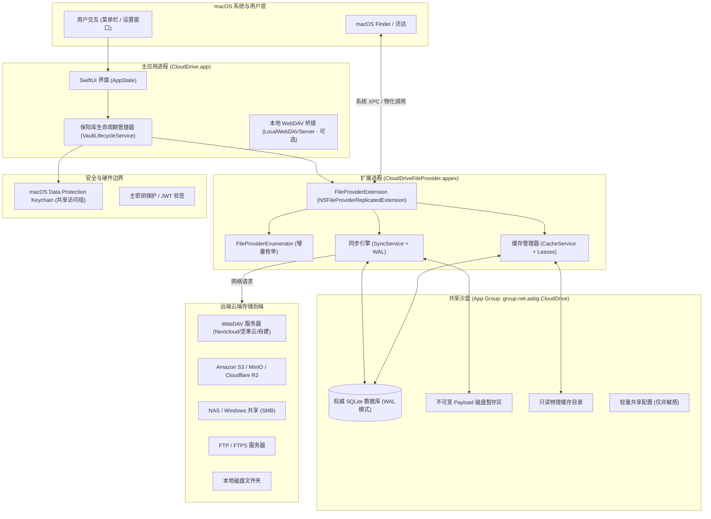

# CloudDrive 系统架构与设计蓝图 (System Architecture)

CloudDrive 是专为 macOS 设计的原生云存储客户端，基于 Apple File Provider 框架实现与 Finder 的原生无缝集成。系统支持多协议远端存储，并深度兼容 Cryptomator 客户端端到端加密格式。

---

## 1. 架构总览与进程拓扑

系统由两个核心运行中进程组成，通过 macOS App Group 共享沙盒与 Keychain 协作：

---

## 2. 核心模块与代码职责

源码按严格的模块化原则组织在 `Sources/` 目录下：

### 2.1 模块分层与 Target 职责
源码遵循高内聚、低耦合的分层架构，各 Target 职责清晰明确：

| 层级 | Target 名称 | 职责说明 |
| :--- | :--- | :--- |
| **基础支撑层** | `CloudDriveContracts` | 核心领域协议接口、数据契约、VFS 抽象定义与只读常量 |
| | `CloudDriveSupport` | 基础日志系统 (`Logger`)、沙盒路径布局 (`CloudDrivePaths`)、全局偏好设置 (`AppSettings`) |
| **持久化与安全** | `CloudDrivePersistence` | SQLite WAL 权威数据库连接、表结构迁移与 Repository 数据访问仓库 |
| | `CloudDriveSecurity` | macOS Data Protection Keychain 证书/密钥持久化与系统沙盒安全边界 |
| **加密与格式** | `CloudDriveCrypto` | Cryptomator 兼容的客户端端到端加密驱动 (AES-256-GCM + Scrypt) |
| | `CloudDriveVaultFormat` | 保险库磁盘布局格式计算与密钥载荷管理 |
| **存储适配层** | `CloudDriveStorage` | 多协议底层网络驱动：**WebDAV** (生产就绪) 以及 S3 / SMB / FTP / Local (演进中) |
| **核心业务层** | `CloudDriveCache` | 物理磁盘两级缓存、不可变 Payload 暂存管理、Cache 租约与 LRU 智能驱逐引擎 |
| | `CloudDriveRecovery` | 回收站存储管理、软删除墓碑生命周期维护与安全恢复机制 |
| | `CloudDriveVFS` | 虚拟文件系统操作路由、DirectMapping 直连映射与加密文件系统映射 |
| | `CloudDriveSync` | 权威同步引擎：不可变代次调度、ETag 条件请求、冲突分叉与故障重试状态机 |
| | `CloudDrivePreview` | 文件缩略图与 QuickLook 预览生成适配 |
| | `CloudDriveSystem` | 系统底层桥接、错误转换与 FileProvider 统一域服务 |
| | `CloudDriveCore` | 保险库生命周期管理 (`VaultLifecycleService`) 与对外统一门面 |
| **宿主应用层** | `CloudDrive` (App) | SwiftUI 主应用、状态栏常驻菜单、保险库创建与配置向导界面 |
| | `CloudDriveFileProvider` | Apple File Provider 现代扩展 (`NSFileProviderReplicatedExtension`)，负责 Finder 无缝接入 |

---

## 3. 设计文档体系索引

为了保证架构严谨性与数据绝对安全，请参考以下专项设计文档：

1. **[使用与操作指南](usage-guide.md)** (`docs/usage-guide.md`)
   - 快速构建安装、WebDAV 接入、Cryptomator 保险库挂载步骤。
   - Finder 原生按需下载、空间释放与常见问题排查 (FAQ)。
2. **[数据安全审查与风险登记表](data-safety-review.md)** (`docs/data-safety-review.md`)
   - 梳理 S01~S26 项高危数据风险点。
   - 确立“不丢数据、不盲删、不盲覆盖、错误必抛”的核心安全红线。
   - 包含必须通过的 14 项故障注入与极端并发验收矩阵。
3. **[同步内核与状态机规范](sync-specification.md)** (`docs/sync-specification.md`)
   - 完整状态转换机图 (State Machine)。
   - 权威 SQLite 表结构 DDL（WAL 表、对象代次表、墓碑表、缓存租约表、变更日志表）。
   - 新建/修改/删除的因果提交顺序与冲突自动分叉协议。
4. **[多协议存储能力与限制矩阵](storage-matrix.md)** (`docs/storage-matrix.md`)
   - WebDAV、S3、SMB、FTP、Local 的条件请求、原子替换、分页枚举能力横向对比。
   - 各存储协议的防护边界与设计权衡。
5. **[模块化架构拆分方案](modularization-plan.md)** (`docs/modularization-plan.md`)
   - 分层 Target 拓扑依赖设计与演进历程。

---

## 4. 构建、测试与运行

- **测试套件**：统一执行 `./scripts/test.sh` 或 `swift run CloudDriveTestsRunner`。测试源码位于 `Tests/CloudDriveCoreTests/`。
- **构建安装**：运行 `./scripts/install.sh` 进行 Release 编译、代码签名并覆盖安装至 `/Applications/CloudDrive.app`。
