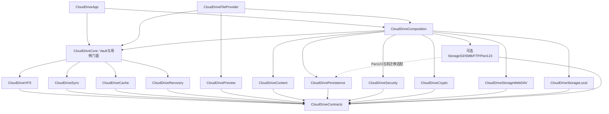

# CloudDrive 多人开发模块拆分设计

版本：实施归档 v2，2026-10-03。状态：✅ 已完成分层 Target 拆分并落地至 Package.swift 及 Xcode 工程，单元与集成测试全量通过。

适用场景：个人开发者维护、多人或多个 agent 在单一仓库协作；WebDAV 是首要支持后端，保留现有 Local、S3、SMB、FTP、123 云盘能力。采用一个 Swift Package、多个 targets，应用与扩展仍由 Xcode 打包。数据安全是拆分验收的一部分，不能用文件移动代替机制修复。

## 1. 对提供方案的调整

| 原方案 | 调整与原因 |
| --- | --- |
| Monorepo Multi-Package | 第一阶段使用单Package、多target。多package增加版本、资源、依赖与Xcode集成成本，目前没有独立发版需求。 |
| Common放Logger、路径、Keychain | Common改名Support，仅放无业务状态的基础设施。路径通过运行环境注入；Keychain单独Security；业务模型与端口进入Contracts。 |
| Database只迁移仓库 | 现有Repository返回VFS模型，会反向依赖Core。先拆领域模型/Repository端口，再让Persistence实现端口。持久操作日志与元数据必须能共享事务。 |
| Crypto直接搬CryptomatorFormat | 当前类注入StorageClient并执行网络创建、删除、复制。必须将密码学/布局计算与远端编排分开，否则依赖与职责不成立。 |
| Storage抽象包含全部驱动和工厂 | 抽象放Contracts，各驱动独立target；工厂放Composition。Core不导入WebDAV/Pan123等实现。 |
| Core依赖Pan123 | 取消。新增驱动只修改装配与配置UI，不让业务Core重新认识后端类。 |
| switch工厂同时宣称动态插件 | 静态注册表足够；不承诺运行时加载插件。Swift Package target不是可动态装载插件。 |
| 零冲突、1–2秒、避免内存强杀、零风险 | 不作此保证。按目录ownership减少冲突，独立构建降低反馈范围；编译性能与扩展内存必须测量。链接裁剪不等于运行时内存安全。 |
| 每模块独立test target | 按你的前述要求保留一个测试模块，内部按模块分组；测试过滤或统一runner选择suite。将来确有需求再加target。 |
| 每个功能立即物理拆分 | 先拆稳定依赖边界，再拆业务状态机。不能在同一PR同时改模块结构、磁盘格式和写入语义。 |

当前代码已经存在Storage/Pan123、RecycleBin，以及StorageWriteMode等变化。下述是目标契约与迁移方案，不能把草案中的每个接口视为当前已实现，也不能用早先安全审查的行号代替实施前核对。

## 2. 总体方案：两级拆分

**落地版先建立物理基础边界，Core内部按业务目录并行开发；业务依赖稳定后，再将这些目录升级为独立target。** 完整设计给出所有最终模块，实施不必一次启用全部target。

第一层稳定模块：Contracts、Support、Persistence、Content、Security、Crypto、各Storage驱动、Composition、Core、Preview、FileProvider、App。Content专门管理不可变内容和文件租约，避免dirty payload的物理所有权落空。

第二层业务拆分：VFS、Sync、Cache、Recovery从Core抽离。Vault生命周期与用例门面留在Core；Core不再承担底层实现。

拆分的核心不是目录数量，而是四条规则：

- UI和FileProvider只提交逻辑文件命令，不构造远端路径、不直接改数据库、不直接删缓存。
- Sync负责网络操作执行与恢复；VFS负责逻辑对象和布局；Persistence负责原子本地提交；Recovery负责保留与回收规则。
- 每个vault具有固定会话和存储环境。App与扩展是两个进程，不共享内存actor，必须通过权威持久日志协调。
- 各后端明确公布能力，不支持条件替换/删除时拒绝危险操作；禁止接口默认实现静默退回盲写。

## 3. 最终依赖图

箭头表示“左侧导入右侧”，不是数据流。Contracts仅依赖Foundation；Support不依赖业务模块。



图中省略各模块对Support的基础依赖和Apple/第三方库依赖。Pan123对Persistence的直接依赖是过渡方案，只允许自身schema与配额事务，不得调用VFS仓库；后续可通过DriverStateStore端口注入去除该依赖。

各业务模块的存储端口也必须在迁移时核对实际语义，而非仅复制旧签名。Crypto实现Contracts定义的VaultCodec/VaultLayout；VFS注入它们，因此不需要导入Cryptomator第三方类型。Composition装配具体实现。Core不依赖Composition，形成明确无环结构。

Composition暂可注册所有现有后端。若以后需要WebDAV专用扩展，把注册函数留给两个产品各自Bootstrap，或增加轻量的CompositionWebDAV target；仅修改启动装配，不修改Core。当前扩展若要支持所有后端，就必须链接所需实现，不能同时承诺“全支持”和“完全裁掉这些依赖”。

## 4. 模块职责与禁止事项

### 4.1 CloudDriveContracts：领域类型与边界协议

拥有：VaultID、ObjectID、GenerationID、OperationID、PayloadID、Revision、RemoteLocator、RemoteVersion、FileRecord、VaultDescriptor、ChangeRecord、StorageCapabilities、错误分类、操作计划与各端口。

协议组：StorageBackend、VaultStore、OperationJournal、PayloadStore、CredentialStore、VaultCodec、VaultLayout、Clock、Reachability、ChangeSink、ThumbnailService。

要求：值类型优先、Sendable、构造时校验；标识符使用不同类型，不能将fileId/remotePath/vaultId混作String。协议只描述跨域必需能力，不公开SQLite句柄、NSFileProviderItem、SwiftUI对象或Masterkey。内部细节留各模块internal。

禁止：单例、网络实现、数据库实现、默认创建真实目录、全局配置工厂、后端专属UI文案。禁止把所有业务协议汇成一个巨大RuntimeProtocol；按读写/生命周期/日志拆小端口。

### 4.2 CloudDriveSupport：技术基础

拥有：结构化日志、日志脱敏、轻量计时、文件原子替换/权限辅助、进程锁基础、取消工具。提供可注入实现，不隐藏数据策略。

Logger不能引用SyncStatus或FileProvider；日志事件带vaultId/operationId，禁止内容、密码、token和敏感URL参数。文件锁助手只负责锁，不决定哪些文件可以删。

SharedPaths改为RuntimeEnvironment显式配置。不能在任意getter中探测失败后静默切换持久根。应用启动验证共享目录，失败返回错误；测试注入临时根。

### 4.3 CloudDrivePersistence：权威事务与迁移

拥有：SQLite连接/statement、schema、migration、事务边界、FileRepository、VaultRepository、OperationJournal实现、墓碑、generation引用、变更revision、后台恢复查询。

唯一拥有schema迁移权限。Repository不向上暴露rawHandle。提供具体的事务命令，例如commitLocalSave、commitRename、confirmRemoteOperation；不要让业务模块拿多个Repository各自写再声称原子完成。

派生数据：目录快照、枚举索引可以重建；dirty payload引用、未完成操作、墓碑、恢复记录不能重建后丢弃。DB损坏进入恢复模式，不能自动把权威记录当缓存清除。

App/扩展共用数据库，通过事务和消费者租约协调。actor只序列化当前进程的连接，不能替代跨进程约束。业务模块只持有端口，不持有连接池。

### 4.4 CloudDriveSecurity：凭据与本地授权

拥有：Keychain凭据、masterkey存储/会话解锁、旧凭据迁移、security-scoped bookmark访问租约、凭据读取验证。

不得将加密库Masterkey公开给UI。对Crypto提供受控会话密钥材料或封装对象，约定生命周期与并发安全；不可承诺普通Swift对象释放自动完成可靠内存擦除。

密码/token仅通过运行时SecretHandle传递，不编码到VaultDescriptor。DP Keychain与签名验证有明确错误；fallback仅为显式兼容策略。解除本地文件访问与删除凭据是不同操作。

### 4.5 CloudDriveStorageWebDAV：首要后端

拥有：WebDAVClient、WebDAVStorageClient、HTTP会话、同源重定向/认证策略、XML解析、href规范化、分页/完整列表语义、条件PUT/DELETE/MOVE/COPY、207逐项结果。

只认识远端对象与条件，不认识FileProvider、cacheManager、VFSDatabase或SyncManager。错误保留HTTP状态、结果未知、部分成功等信息，由业务决定恢复。

方法级重试：GET等读取可以有策略；破坏性写入的结果未知由Sync核对后重放，驱动不能隐藏盲重试。进度回调Sendable且不在同步锁内调用。

### 4.6 CloudDriveStorageLocal及其他后端

Local拥有：根目录句柄、围栏、符号链接策略、原子写入、访问租约。LocalWebDAVServer如果保留，放Local模块作为显式可选桥，不能进入Common，也不作为所有本地访问的默认实现。

S3/SMB/FTP各有独立target、目录和owner。实现同一契约的能力子集。S3必须处理完整分页与对象版本；FTP/SMB不能用exists→覆盖模拟原子CAS。连接配置在各驱动内部编码，凭据单独注入。

Pan123拥有：APIClient、StorageClient、Models、令牌刷新协调、限流、配额计数及驱动状态。Token存Security，不因模块独立就继续写进普通数据库。并发刷新必须有单飞及过期恢复策略。服务限制属于驱动实现，不进入Sync的后端switch。

### 4.7 CloudDriveCrypto：纯密码学与布局

拆开当前CryptomatorFormat：

| 原方法类别 | 目标职责 |
| --- | --- |
| 文件名加密、dirId哈希、JWT验证、流式内容加解密 | Crypto |
| getDirPath/getFileRemotePath、长名布局计算 | Crypto中的CryptomatorLayout，返回计划值，不执行I/O |
| 读取dir.c9r/name.c9s并解释内容 | Crypto解码，VFS负责取得字节 |
| listDirectory/create/upload/delete/move/copy | VFS生成多对象计划，Sync执行与记录步骤 |
| masterkey持久化、bookmark、密码获取 | Security |

输出不泄漏CryptomatorCryptoLib类型。VaultCryptoSession不可跨vault复用；内容认证失败明确错误，不发布部分明文。临时解密由Content提供专属暂存位置和生命周期，Crypto不能自行写用户共享目录。

### 4.8 CloudDriveVFS：逻辑对象和远端布局

拥有：DirectMapping与EncryptedMapping、逻辑根、父子关系、名称规则、布局计划、远端snapshot与本地overlay合并、读写/移动/删除命令准备。

稳定ObjectID不随路径改变。RemoteLocator区分路径后端与ID后端，不能强迫Pan123把ID伪装成路径。目录rename生成后代映射与操作依赖，不能只修改根行。

不直接执行网络重试、物理清cache或向Finder发signal。输出OperationPlan和逻辑结果，由Core提交日志、由Sync执行。pendingDelete overlay隐藏但保留恢复记录。

### 4.9 CloudDriveSync：执行、重放与冲突

拥有：调度、消费者租约、依赖排序、重试/backoff、结果未知核对、版本条件、generation确认、冲突分类、操作阶段恢复。

不依赖具体驱动，也不持有可变VirtualFileSystem.shared。每项操作绑定VaultSessionSnapshot。禁止改写在途payload；前序失败阻塞其依赖，不必阻塞全部独立文件。

队列是持久OperationJournal的查询视图，不再独立维护第二份JSON权威状态。只有确认为本操作产生的远端结果，才调用原子confirm事务。

### 4.10 CloudDriveCache：可丢弃内容与租约

拥有：clean cache、使用/写入租约、pin策略、预算与驱逐、下载发布、materialization handoff。

dirty内容属于PayloadStore，不能归Cache驱逐。Cache只存可证明远端已有副本的generation；暂存最新编辑的副本也必须指向payload并标记不可驱逐。

缓存键为vaultId+objectId+generation，不是随路径变化的fileId。驱逐通过权威状态查询并拿租约，数据读取失败时不能按clean处理。pin intent与是否已下载分开存储。

### 4.11 CloudDriveRecovery：删除保留与恢复

拥有：本地恢复副本、墓碑策略、删除计划的恢复点、保留期限、冲突导出、孤立payload隔离、恢复清单和安全GC。

现有RecycleBin不能整文件移动就视为可靠。需要核对：备份失败是否仍删除、目录是否完整、云端-only能否恢复、trash元数据与删除任务是否事务化。原先可选快照不能替代dirty必须保留。

远端回收站是能力，不能假设所有后端支持。restore是新操作，有目标不存在/版本约束；GC仅处理无引用、已确认、超过保留策略的数据。

### 4.12 CloudDrivePreview：可选媒体处理

拥有：ThumbnailManager、ThumbnailCatalog、媒体解码与生成。依赖CoreGraphics/ImageIO/AVFoundation等；不进入Contracts/Support/Core基础依赖。

通过ContentReadLease读取，不自行完整下载所有文件；受大小、内存与时间预算限制。缓存同样按vault/object/generation隔离，不能随缩略图服务自动上传sidecar修改用户远端目录。

### 4.13 CloudDriveCore：产品用例与Vault生命周期

拥有：VaultService、VaultSession actor、FileUseCases、ConflictUseCases、RecoveryUseCases、稳定的App/Finder服务门面。

一次保存用例协调VFS计划、payload、Persistence事务和Sync唤醒；不自行重新实现驱动路径或SQL。VaultSession状态显式区分opening、ready、closing、locked、recoveryRequired。

VaultSession只负责会话状态与授权，save/rename/delete/read门面转交独立用例，不在actor文件中实现全部流程。Core不包含NSFileProviderManager和SwiftUI，不含后台媒体解码、不认识Pan123具体类。临时旧API兼容放Compatibility目录并有删除期限，禁止新增调用.shared。

### 4.14 CloudDriveComposition：唯一装配入口

拥有：StorageBackendRegistry、RuntimeFactory、产品能力集、VaultSession依赖装配、迁移兼容适配器。它可以认识具体驱动和Persistence/Security/Crypto实现。

工厂输入VaultDescriptor+凭据句柄+RuntimeEnvironment，输出会话或明确错误。非法配置不能fallback localhost，未注册驱动不能fallback Local。

注册发生在启动时，注册表构建后冻结；禁止任意业务代码动态改全局工厂。App与扩展各初始化自己的runtime，但指向相同权威存储与vault身份。

### 4.15 CloudDriveFileProvider与CloudDriveApp

FileProvider拥有：NSFileProvider适配、item/version/error映射、枚举分页与anchor、signal、Progress取消与回调生命周期、Domain注册。核心事件以ChangeSink输出，再转换为系统signal。FileProviderSync、DomainService、EnumeratorSignaler、VFSErrorBridge迁到这里。

Extension不能上传PUT、拼remotePath、直接写缓存/删除DB行。返回保存成功必须来自Core提供的LocalCommitReceipt；synced来自远端确认，二者不能混淆。

App拥有：SwiftUI、AppState/ViewModels、设置与日志界面、托盘、各后端配置表单。Credentials由Security接口提交，不让ViewModel自行写UserDefaults共享密码。Pan123配额UI读标准或驱动扩展facade，不导入SQLite。

## 5. 目标目录结构

以下是最终展开目录。第一阶段VFS/Sync/Cache/Recovery仍可以作为Core内部目录，测试始终只有一个target。

```text
Sources/
  CloudDriveContracts/
    Identity/ Models/ Storage/ Persistence/ Security/ Crypto/ Events/
  CloudDriveSupport/
    Logging/ Files/ Locks/ Time/
  CloudDrivePersistence/
    SQLite/ Schema/ Migrations/ Repositories/ Transactions/ Journal/ RecoveryIndex/
  CloudDriveContent/
    Staging/ Objects/ Leases/ Integrity/ Publication/
  CloudDriveSecurity/
    Keychain/ Secrets/ Bookmarks/ Migration/
  CloudDriveCrypto/
    Cryptomator/ Layout/ Streams/ Sessions/
  CloudDriveStorageWebDAV/
    Transport/ Authentication/ XML/ Paths/ Operations/ Configuration/
  CloudDriveStorageLocal/
    Access/ Paths/ Operations/ OptionalBridge/
  CloudDriveStorageS3/
  CloudDriveStorageSMB/
  CloudDriveStorageFTP/
  CloudDriveStoragePan123/
    API/ Authentication/ RateLimit/ State/ Configuration/
  CloudDriveVFS/
    Mapping/ Plans/ Snapshot/ Overlay/ Validation/
  CloudDriveSync/
    Scheduling/ Execution/ Reconciliation/ Conflict/ Recovery/
  CloudDriveCache/
    Content/ Leases/ Policy/ Eviction/ Handoff/
  CloudDriveRecovery/
    Trash/ Conflicts/ Export/ Retention/ GarbageCollection/
  CloudDrivePreview/
    Image/ PDF/ Video/ Cache/
  CloudDriveCore/
    Vault/ UseCases/ Services/ Compatibility/
  CloudDriveComposition/
    Registry/ Runtime/ Bootstrap/
  CloudDriveFileProvider/
    Domain/ Enumeration/ Items/ Operations/ Signals/ Errors/
  CloudDrive/                 # 保持现有应用目录，不为target名重复改路径
    Views/ ViewModels/ Settings/ StorageForms/ Assets.xcassets/
Tests/
  CloudDriveTests/            # 目标测试目录；初期保留现有CloudDriveCoreTests路径
    Contracts/ Persistence/ Security/ Crypto/ Storage/
    VFS/ Sync/ Cache/ Recovery/ FileProvider/ Integration/
    Support/ Fixtures/ FaultInjection/
docs/
  architecture.md            # 当前已实施结构
  modularization-plan.md     # 本设计与迁移状态
  data-safety-review.md      # 安全问题与验收矩阵
scripts/
  test.sh install.sh patches/
Package.swift
CloudDrive.xcodeproj/
```

不创建空壳目录，不为未支持网盘提前建target。大型文件先按职责拆内部文件，再迁移模块；不要只制造许多只有一个转发类的模块。

## 6. 关键跨模块契约

下列Swift仅为接口设计示意，不是可直接编译的完整实现。每个类型的字段、Codable版本与迁移策略须在契约PR中定义。

```swift
public enum WriteCondition: Sendable {
    case createIfAbsent
    case replace(RemoteVersion)
    // 强制覆盖使用独立受控命令，不作为普通写入的默认值
}

public protocol StorageBackend: Sendable {
    var capabilities: StorageCapabilities { get }
    func list(_ container: RemoteLocator,
              cursor: PageCursor?) async throws -> DirectoryPage
    func stat(_ object: RemoteLocator) async throws -> RemoteObject
    func read(_ request: ReadRequest,
              into sink: ContentSink) async throws -> ReadReceipt
    func write(_ request: WriteRequest,
               from source: ImmutableContentSource) async throws -> WriteReceipt
    func mutate(_ request: MutationRequest) async throws -> MutationReceipt
    func reconcile(_ attempt: RecordedAttempt) async throws -> RemoteOutcome
}

public protocol VaultStore: Sendable {
    func commitLocalSave(_ request: PreparedLocalSave) async throws -> LocalCommitReceipt
    func commitPlan(_ plan: PreparedOperationPlan) async throws -> LocalCommitReceipt
    func confirmRemote(_ result: RecordedRemoteResult) async throws -> CommitRevision
    func changes(after revision: CommitRevision,
                 in scope: ChangeScope) async throws -> ChangePage
}

public protocol PayloadStore: Sendable {
    func prepare(from input: ContentInput,
                 scope: PayloadScope) async throws -> PreparedPayload
    func open(_ id: PayloadID) async throws -> PayloadReadLease
}

public actor VaultSession {
    // 环境与backend固定；不能在挂载期间原地换连接
    public func save(_ command: SaveCommand) async throws -> LocalCommitReceipt
    public func rename(_ command: RenameCommand) async throws -> LocalCommitReceipt
    public func delete(_ command: DeleteCommand) async throws -> LocalCommitReceipt
    public func read(_ command: ReadCommand) async throws -> ContentReadLease
    public func close(_ policy: ClosePolicy) async throws
}
```

Receipt语义：LocalCommitReceipt证明payload与日志已可靠提交；WriteReceipt证明本次远端写入结果，包含实际版本和结果身份；MutationReceipt可为partialSuccess；RemoteOutcome区分confirmed、notApplied、conflicting和unknown。只返回String? ETag不足以表达这几种状态。

DirectoryPage必须有nextCursor以及是否完整的信息，只有取完且验证全部页面的结果才能参与删除diff。Capabilities是明确支持/不支持的语义，不是“有这个方法”。缺原子条件写时，VFS/Core不能用预检查模拟安全。

错误应区分：invalidConfiguration、unauthenticated、permissionDenied、notFound、versionConflict、partialFailure、outcomeUnknown、corruptState、diskFull、cancelled。取消已本地提交任务与取消未提交输入有不同语义；取消不能使已经确认保存的数据消失。

## 7. 数据所有权与一致性

| 数据/状态 | 唯一写入所有者 | 其他模块如何访问 |
| --- | --- | --- |
| vault身份、对象generation、墓碑、revision | Persistence事务API | Core提交命令，VFS读取快照，FP读取变更 |
| 操作phase、依赖、远端确认 | Persistence保存，Sync提供状态迁移命令 | Core/FP通过只读查询，不自己修改JSON |
| dirty/冲突payload文件 | Content提供物理存储，Persistence保存引用，Recovery决定保留策略 | Sync/Cache/Preview持Content租约读取 |
| clean cache、pin意图、使用租约 | Cache，权威引用由Store保存 | Core请求，不调用底层remove |
| 密码、token、masterkey、bookmark租约 | Security | 按会话提供，不序列化到配置 |
| backend配额与驱动本地索引 | 驱动状态仓库 | 驱动自身事务，App读公开状态 |
| Finder anchor/materialized view | FileProvider派生状态 | 与核心commit revision关联，可过期重扫 |
| 远端文件实际内容 | 对应backend操作 | VFS不直接发请求；Sync确认结果 |

保留“一个事务跨业务数据”的能力，比给每个模块单独一份JSON或数据库更重要。模块物理隔离不要求持久状态物理割裂。

安全流程固定为：准备不可变payload → 原子提交对象代次/操作/引用 → 向系统确认本地保存 → 执行条件远端操作 → 核对未知结果 → 原子确认本代次 → 无引用且满足保留期后回收。详见数据安全审查文档；目录拆分不能改变这条顺序。

## 8. 现有文件迁移映射

| 现有文件/目录 | 目标 | 必须先拆开的依赖 |
| --- | --- | --- |
| Logger.swift | Support/Logging | 排除业务/系统适配依赖 |
| CloudDrivePaths.swift | Composition环境配置 + Support文件工具 | 去掉随getter静默回退权威根 |
| KeychainService.swift、CredentialStore | Security/Keychain | 隐藏Masterkey类型、可检查错误 |
| SecurityScopedBookmarkHandler | Security/Bookmarks | 用访问租约代替全局访问标志 |
| VFS/Models、SyncStatus、VaultInfo | Contracts领域模型 | 去掉密码配置和平台模型；区分持久/展示类型 |
| StorageClient、StorageResource、StorageWriteMode | Contracts/Storage | 拆后端能力与操作结果，不搬工厂 |
| StorageConfiguration | Contracts连接描述 + 驱动配置 | 统一enum过渡可保留，长期用kind/schemaVersion/payload避免每加驱动改公共enum |
| StorageClientFactory | Composition/Registry | 移除Core→具体驱动依赖 |
| WebDAVClient、Storage/WebDAV | StorageWebDAV | 不引入Sync/Cache/VFS错误实现 |
| Storage/Local、LocalWebDAVServer | StorageLocal | 明确桥接边界、安全根和认证策略 |
| Storage/S3、SMB、FTP、Pan123 | 各Storage target | Pan123 DB状态与凭据解耦 |
| Database/**、VFSDatabase | Persistence | DTO进Contracts；事务接口不可被rawHandle绕过 |
| CryptomatorVaultConfig、VFSEncryption | Crypto | 第三方类型包装，Keychain另移 |
| CryptomatorFormat | Crypto布局/密码学 + VFS计划 + Sync执行 | 不直接整体搬迁 |
| VFS/Providers、VirtualFileSystem | VFS映射 + Core/VaultSession | 去掉shared、网络执行和直接缓存清理 |
| Sync/**、SyncManager | Sync + Persistence/Journal | 合并JSON权威状态，注入端口 |
| Cache/**、CacheManager | Cache + PayloadStore | dirty与clean分离，移除SyncManager反向引用 |
| RecycleBin/** | Recovery | 可靠备份/目录计划/事务日志，不只移动目录 |
| Operations/Pipelines | Sync/Execution或Core/UseCases | 与真实主路径合并，避免两套执行机制 |
| Operations/Tracker | Core只读任务视图 | 状态由commit事件驱动，不重复拥有事务 |
| ThumbnailManager、ThumbnailCatalog | Preview | 文件读取租约与vault范围 |
| DirectoryThumbnailCatalogManager | Preview可选派生索引 | 不默认上传sidecar |
| FileProviderSync、Vault/Domain、VFSErrorBridge | FileProvider | Core改输出ChangeSink及领域错误 |
| Vault/Registry、VaultLifecycleService | Persistence vault仓库 + Core生命周期 | 凭据迁移交Security，Domain交FP |
| IgnoreRuleEngine、VaultIgnoreManager | VFS/Validation或Core策略 | 忽略规则不能授权删除dirty内容 |

先保留原外观API的适配器，内部转到新门面；调用方逐批切换后删除适配器。无需大面积public化旧类；只公开实际跨模块契约。

## 9. SPM与Xcode设计

一个Package.swift声明targets。内部targets不用全部声明library product；对应用/扩展公开Core、Composition和确有独立使用需求的库。框架product越多不等于模块边界更好。

初期Core包含VFS/Sync/Cache/Recovery目录，依赖Contracts/Support；Composition依赖Core、Persistence、Content、Security、Crypto及启用的Storage实现；拆业务targets后Core依赖相应业务模块，装配接口保持不变。

示例骨架（设计伪配置，不覆盖当前工程）：

```swift
.target(name: "CloudDriveContracts"),
.target(name: "CloudDriveSupport"),
.target(name: "CloudDrivePersistence",
        dependencies: ["CloudDriveContracts", "CloudDriveSupport"],
        linkerSettings: [.linkedLibrary("sqlite3")]),
.target(name: "CloudDriveSecurity",
        dependencies: ["CloudDriveContracts", "CloudDriveSupport"]),
.target(name: "CloudDriveCrypto",
        dependencies: ["CloudDriveContracts", "CloudDriveSupport",
                       .product(name: "CryptomatorCryptoLib", package: "cryptolib-swift")]),
.target(name: "CloudDriveStorageWebDAV",
        dependencies: ["CloudDriveContracts", "CloudDriveSupport"]),
.target(name: "CloudDriveCore",
        dependencies: ["CloudDriveContracts", "CloudDriveSupport"]),
.target(name: "CloudDriveComposition",
        dependencies: ["CloudDriveCore", "CloudDrivePersistence",
                       "CloudDriveContent", "CloudDriveSecurity", "CloudDriveCrypto",
                       "CloudDriveStorageWebDAV", "CloudDriveStorageLocal"])
```

此示例省略Content的target声明、其他驱动、Preview、App/FP和测试声明。Pan123当前若需要SQLite wrapper，则明确依赖Persistence并只使用授权子接口。

Xcode集成采用单一路径：本地Package提供业务模块；App target与Extension target链接Package products。逐步移除旧CloudDriveCore framework target中重复编译的源文件，不能SPM编一遍、Xcode同步组再编一遍。资源、Info.plist、entitlements、嵌入Extension与签名保留Xcode职责。

同时验证App和Extension链接，避免只通过SPM却漏掉资源或运行时框架。第三方密码库只有Crypto直接import，其他模块通过Contracts使用；传递链接仍会存在，不能声称下游完全不链接加密库。

## 10. 多人并行实施计划

### 10.1 建立契约后再并行搬文件

先由架构负责人合入Contracts与边界ADR，冻结第一版签名及配置兼容策略。随后四条工作线可并行：

| 工作线 | 所有权范围 | 交付 | 不修改 |
| --- | --- | --- | --- |
| A：持久化/安全 | Persistence、Security，测试对应目录 | 事务端口、migration、共享凭据、隔离fixture | Core业务执行、驱动与UI |
| B：存储 | StorageWebDAV/Local及其他驱动 | 契约实现、能力/条件/207测试、配置codec | VFS路径策略、操作日志schema |
| C：业务机制 | Core内部VFS/Sync/Cache/Recovery | 去全局状态、操作计划、payload生命周期与恢复 | backend HTTP细节、App/FP回调 |
| D：系统/界面 | FileProvider、App、Preview | 门面调用、版本/anchor/错误适配、可恢复UI | 直接SQL/PUT/delete-cache |

C线还可细分Sync与VFS/Cache负责人，但状态事务接口必须共同review，不能各自维护互不一致的成功条件。每人用独立分支/worktree；同目录交接时明确文件owner和基线commit。

### 10.2 高频冲突文件

Package.swift、project.pbxproj、Contracts接口、schema migration清单、测试总入口由集成负责人集中维护。模块负责人提供依赖增量与注册函数，集成负责人按序合入，不让所有PR同时重写工厂switch。

CODEOWNERS用于review归属，不能当作权限隔离。仓库实际权限与branch规则独立配置。示例owner仅是角色占位，实施时换真实账号，未经授权不创建远端规则。

PR范围：一个稳定边界或一种安全机制；源码搬迁与语义改变分开。接口变更提供兼容适配器和调用方迁移清单，禁止靠“全部public”解决编译错误。

### 10.3 接口交接文件

每个模块交付同一种简洁契约记录：公开类型、依赖、线程/actor要求、取消语义、错误、状态所有权、临时文件责任、允许的副作用、能力限制、测试入口、迁移/回滚条件。记录集中在本设计或模块README，避免重复维护多份矛盾规范。

分支按仓库惯例使用codex/前缀，例如codex/module-webdav、codex/module-persistence；合并基线不断更新，禁止长时间各自在不同版本修改同一协议。

## 11. 迁移阶段与门禁

| 阶段 | 具体工作 | 完成标准 | 回滚边界 |
| --- | --- | --- | --- |
| 0 基线 | 核对当前实现、编译、隔离测试、数据格式；列安全阻断项 | 可重复基线，故障测试至少建立；不假设未验证修复已通过 | 不改数据 |
| 1 契约 | 抽ID/DTO/端口、错误与能力；旧Core适配新类型 | 无循环依赖，无UI/第三方泄漏；现有调用可继续运行 | 适配器可退回 |
| 2 基础实现 | Support/Persistence/Security分target；仍沿用旧磁盘格式 | App/FP共用根和凭据验证；Repo类型无反向依赖 | 仅代码搬迁，无schema写升级 |
| 3 驱动 | WebDAV优先，Local及其余各驱动分离；Composition注册 | Core无具体驱动import；子路径/条件/部分结果测试 | 产品注册可回退 |
| 4 密码学 | 拆CryptomatorFormat为codec/layout/plan | 同一测试向量及历史vault读取兼容；不自动修改用户vault | 保留旧codec适配器 |
| 5 业务去耦 | Core内部VFS/Sync/Cache/Recovery改注入；统一事务端口 | 无业务.shared、无FP路径拼接；真实主路径唯一 | 旧API桥，禁止双消费者 |
| 6 数据安全迁移 | 统一journal/schema/payload引用、墓碑、恢复与GC | 各崩溃窗口及未知结果通过；迁移生成恢复清单 | 备份+格式版本；升级后旧版本需只读或拒绝 |
| 7 业务物理拆分 | 内部四业务目录升级targets；Preview单独 | DAG检查、独立build、App/FP全构建与系统验证 | 只改编译归属 |
| 8 收敛 | 删除Compatibility与废执行路径，更新ownership | 所有调用进入新用例门面；文档反映真实实现 | 无需长期双结构 |

数据格式迁移只在阶段6独立进行。不能在搬源码时顺便重命名缓存目录、删除历史队列、重建库或换vault ID。旧全局任务无法确定归属时隔离导出，不自动绑定当前连接。schema升级和代码降级必须明确兼容，git revert不是数据回滚方案。

## 12. 一个测试模块的协作设计

保留CloudDriveTestsRunner作为第一阶段唯一入口，测试文件按模块分组，公共fixture由Tests/Support提供。后续若统一改为一个XCTest target，则替换runner，不同时保留两个重复套件；需专门迁移PR。

设计suite选择：scripts/test.sh --suite WebDAV/Sync/...。这是拟新增的接口，当前不假设存在。实现前仍使用现有--regression-only；不能把swift test --target某模块当作当前有效命令。

模块反馈可以用swift build --target CloudDriveStorageWebDAV（target落地后）。单一测试target通常会编译它声明的全部依赖，即使只执行一个suite也不保证只编译该模块，不能承诺1–2秒。

测试策略：

- Contracts：类型区分、路径/版本校验、配置codec前后兼容。
- Persistence：事务rollback、跨进程写入、DB损坏、schema升级与中断。
- WebDAV：条件create/replace/delete、207、结果未知、重定向、Unicode、完整列表。
- Crypto：官方兼容向量、长名、NFC、签名错误、认证失败、流式大文件；不自行发明算法。
- Sync：generation并发、rename/delete依赖、租约、未知结果核对、重复重放。
- Cache/Recovery：dirty不可驱逐、使用租约、删除保留、恢复/GC引用约束。
- FileProvider：保存receipt、版本/anchor、取消和重启、待删项不复活。
- Integration：专用测试vault验证App与扩展实际共享、真实WebDAV和多阶段中断。

CI分级：受影响target编译与相关suite → 全部隔离回归 → App+Extension Xcode打包检查 → 周期/发布前真机系统集成。架构门禁拒绝禁止import、逆向依赖、业务新增.shared及FP手工拼远端路径。静态规则辅助review，不能代替故障注入。

## 13. 设计验收与实施优先级

模块拆分完成的判据：依赖无环；驱动可替换；App/FP只访问用例；权威状态有唯一事务所有者；vault会话隔离；新增驱动无需改Core；测试使用临时环境；Xcode不重复编译模块；旧API/数据有明确迁移退出路径。

建议第一批仅做Contracts、Support、WebDAV独立与Composition装配，并建立事务/故障契约。第二批做Persistence/Content/Security与Crypto职责分离；第三批重构业务状态机；最后升级业务targets。优先解决已识别的数据安全阻断项，不用“模块拆完”作为安全发布依据。

本次v2补充以第14–18节为粒度与协作约束；与前文概括有歧义时以具体职责表为准。

本设计没有估算固定工期：当前存在并行改动与未验证机制，阶段0结果决定后续工作量。多人开发降低代码争用，但操作日志、数据版本与安全语义仍需一个统一设计和集成负责人。

## 14. v2复审：多人开发的真实隔离边界

多人开发无法保证任何修改都互不影响。合理目标是：**实现细节修改限定在自己的功能目录；依赖既有契约即可独立编码、测试和合入；改变公共语义时通过明确的协作流程传播，不能静默破坏消费者。**

上一版还有六个需要收紧的地方：

| 问题 | v2决定 |
| --- | --- |
| Core同时负责所有用例，容易形成新的巨型管理器 | 一个命令流程一个UseCase；VaultSession只管生命周期和会话授权；读模型与写用例分开。 |
| Contracts集中所有协议，所有人争用一个文件 | 按端口领域分目录，每个协议/类型族独立文件并有领域owner；实现PR不改变契约。先保留一个target，不增加十几个只含协议的targets。 |
| PayloadStore有协议，没有明确实现所有者 | 新增Content target：不可变文件、校验、发布和租约归Content；引用归Persistence；保留/回收决策归Recovery。 |
| Persistence可能变成一个超级Repository或Store | 小Repository只提供internal SQL；公开事务命令按保存/移动/删除/确认拆文件，共用一次数据库事务。 |
| Sync仍可能按所有operation做一个巨型switch | 调度和执行分离；按操作类型独立Executor；重放/核对按操作语义独立Resolver。 |
| 装配/测试/迁移入口仍是共享修改热点 | 启动构图分模块Assembly；后端/执行器提供注册贡献；测试优先最终收敛一个可发现的XCTest target；schema迁移按独立文件及序号协调。 |

### 14.1 区分三个粒度

- **target是依赖与编译边界**：稳定业务域或驱动一个target。不能每个按钮/HTTP方法一个target。
- **功能目录是多人ownership边界**：例如WebDAV/Delete、Sync/Execution/Delete、Core/UseCases/Delete，各自在自己的层实现自己的责任。
- **文件是可解释的职责边界**：一个主要类型/算法/流程一个文件；紧密相关的小值类型可以同文件。不要把几十个任意类型塞进Models.swift或Utils.swift。

判断是否拆文件看“变化原因”而非行数：认证政策与XML解析变化原因不同，必须分开；同一个事务的几条SQL属于同一变化单元，可以同文件。建议主要业务文件保持约100–300行作为review提醒，超过400行检查职责；不是机械限额。复杂解析器可按tokenizer、response model、validator拆分，但不要拆成几十个只转发的类。

### 14.2 每个文件的职责说明

每个主要类型明确：输入、输出、持有状态、依赖端口、允许副作用、失败行为、owner与对应测试。与类型定义放在一起，避免文档和实现各维护一份重复接口。

不得新增泛用Manager、Helper、Service承接不属于任何人的代码。命名必须说明任务，例如LocalSaveCommitter、RemoteDeleteExecutor、DirectoryOverlayMerger。命名清楚仍不等于边界正确：能访问所有依赖的类同样可能成为超级管理器。

## 15. 文件级职责目录与交接单元

以下为推荐主文件清单，辅助DTO、错误与测试按同功能就近放置；不是预先创建全部空文件。括号中的路径相对对应target目录。每行是一项明确的交接单元。

### 15.1 Contracts / Support / Content

| 目录/主文件 | 唯一职责 | 明确不负责 |
| --- | --- | --- |
| Contracts/Identity/VaultID.swift、ObjectID.swift、GenerationID.swift | 不同身份的强类型、合法构造 | 生成远端路径、持久化 |
| Contracts/Files/FileRecord.swift | 对象快照字段 | UI文案、SQL、Finder类型 |
| Contracts/Files/LocalCommitReceipt.swift | 本地提交结果及revision | 判断远端已同步 |
| Contracts/Storage/RemoteLocator.swift | 后端地址类型与值语义 | HTTP URL构造 |
| Contracts/Storage/RemoteVersion.swift | 强版本、未知/无版本的明确表达 | 以mtime假扮ETag |
| Contracts/Storage/StorageBackend.swift | 远端I/O端口 | 默认盲写实现 |
| Contracts/Storage/StorageCapabilities.swift | 方法级安全能力 | UI配置开关 |
| Contracts/Storage/WriteRequest.swift、MutationRequest.swift | 请求前置条件与输入模型 | 实际执行、重试 |
| Contracts/Storage/WriteReceipt.swift、MutationReceipt.swift | 确认/部分成功结果 | 吞掉子项失败 |
| Contracts/Persistence/VaultReadStore.swift | 按vault/object/revision读取 | 修改状态 |
| Contracts/Persistence/LocalCommitStore.swift | 保存/移动/删除的原子提交端口 | 单项SQL公开 |
| Contracts/Persistence/RemoteCommitStore.swift | 原子确认远端结果 | 网络核对 |
| Contracts/Content/PayloadStore.swift、ContentReadLease.swift | 内容准备与租约契约 | 回收期限政策 |
| Contracts/Crypto/VaultCodec.swift、VaultLayout.swift | 字节编解码/布局计划契约 | 请求网络 |
| Contracts/Events/ChangeFeed.swift | 可重读的提交事件接口 | Finder signal、内存回调代替日志 |
| Support/Logging/LogSink.swift、LogRedactor.swift | 输出日志、脱敏，分别负责 | 同步状态判断 |
| Support/Files/AtomicFilePublisher.swift | 单文件原子发布和I/O错误 | 数据能否回收 |
| Support/Files/FileDurability.swift | 文件/父目录落盘策略 | 宣布完整业务事务完成 |
| Support/Locks/ProcessLease.swift | 跨进程锁获取/释放 | 哪个vault任务先执行 |
| Content/Staging/PayloadPreparer.swift | 复制输入、生成不可变暂存对象 | 向Finder确认保存 |
| Content/Integrity/PayloadVerifier.swift | 大小/哈希/完整性检查 | 远端冲突判断 |
| Content/Publication/PayloadPublisher.swift | 校验后发布固定PayloadID | 添加对象generation/操作日志 |
| Content/Objects/PayloadReader.swift | 打开已发布内容 | 寻找“当前活跃vault” |
| Content/Leases/ContentLeaseRegistry.swift | 读/写/删除互斥和租约 | pin与预算 |
| Content/Objects/UnreferencedPayloadScanner.swift | 枚举未被权威Store引用的候选 | 自行删除候选 |
| Content/Objects/PayloadDisposer.swift | 根据已批准GC清单物理移除 | 自行判断保留期限 |

Content只依赖Contracts/Support，注入只读引用检查端口；不导入Persistence实现。扫描→批准→删除仍需最终引用复核与租约，扫描时“无引用”不能永远有效。

### 15.2 Persistence：SQL与事务分别归属

| 主文件 | 唯一职责 | 明确不负责 |
| --- | --- | --- |
| SQLite/SQLiteConnection.swift | 连接生命周期与参数 | vault业务 |
| SQLite/SQLiteStatement.swift | 绑定、step、column及错误 | 跨Repository提交 |
| SQLite/TransactionRunner.swift | 开启/提交/回滚一次事务 | 执行网络await |
| Schema/SchemaVersion.swift | 读取/比较存储版本 | 所有migration SQL |
| Migrations/MigrationRunner.swift | 检查、排序、执行迁移 | 随意重建损坏库 |
| Migrations/M0001InitialSchema.swift等 | 一个版本的升级/验证步骤 | 别的版本补丁 |
| Repositories/ObjectRepository.swift | internal对象行读写 | 调用缓存清理 |
| Repositories/GenerationRepository.swift | internal代次及payload引用 | 实际文件复制 |
| Repositories/OperationRepository.swift | internal计划、依赖、执行阶段 | backoff算法 |
| Repositories/TombstoneRepository.swift | internal墓碑与恢复关联 | 删除远端对象 |
| Repositories/ChangeRepository.swift | internal提交revision及变更 | 系统枚举回调 |
| Transactions/LocalSaveCommitter.swift | 一个事务提交对象代次、引用、任务与变更 | staging复制与PUT |
| Transactions/RenameCommitter.swift | 一个事务提交逻辑rename及依赖/后代映射 | MOVE网络请求 |
| Transactions/DeleteCommitter.swift | 一个事务提交墓碑、恢复引用与delete任务 | 提前释放唯一副本 |
| Transactions/RemoteResultCommitter.swift | 确认具体代次、后继基线与任务结果 | 猜测未知网络结果 |
| Queries/RecoveryQuery.swift | 启动恢复需要的事实查询 | 自动删孤立内容 |
| Queries/ChangeQuery.swift | revision分页与过期判断 | 构造NSFileProviderItem |

SQL helper只能internal；业务通过事务端口提交。各Committer由统一PersistenceStore门面短委派，对外不暴露表。委派门面只组装依赖，不能再实现一遍所有事务。

### 15.3 WebDAV：每种协议功能独立

| 主文件 | 唯一职责 | 明确不负责 |
| --- | --- | --- |
| Configuration/WebDAVConfiguration.swift | 非秘密配置decode/校验 | Keychain写入 |
| Transport/HTTPTransport.swift | 请求发送、流式输入输出、取消 | 所有WebDAV业务方法 |
| Transport/RedirectPolicy.swift | 同源/降级政策 | 根据错误强制续传 |
| Authentication/WebDAVCredentialProvider.swift | 获取会话凭据并添加授权 | 全局活动密码fallback |
| Paths/DAVLocatorResolver.swift | 根内locator↔URL规范化 | 用displayName替代资源身份 |
| XML/DAVMultiStatusDecoder.swift | 解码XML为响应模型 | 判断业务操作最终成功 |
| XML/DAVResponseValidator.swift | 响应集合完整性、状态/类型检查 | 删除本地缺失项 |
| Operations/List/DAVDirectoryLister.swift | PROPFIND列表，完整结果语义 | 与本地DB做diff |
| Operations/Stat/DAVObjectInspector.swift | 单对象类型/版本读取 | exists错误返回false |
| Operations/Read/DAVFileReader.swift | GET基线与完整下载回执 | 缓存预算 |
| Operations/Write/DAVFileWriter.swift | create/replace条件PUT与响应版本 | 自动强制覆盖 |
| Operations/CreateDirectory/DAVCollectionCreator.swift | MKCOL及collection核验 | 加密目录UUID设计 |
| Operations/Delete/DAVDeleteExecutor.swift | 条件DELETE、207结果 | 应用删除墓碑 |
| Operations/Move/DAVMoveExecutor.swift | 源条件、目标不覆盖与MOVE结果 | 更新目录parent关系 |
| Operations/Copy/DAVCopyExecutor.swift | 源版本、目标约束与COPY结果 | 将旧缓存标记新副本 |
| Reconciliation/DAVOutcomeInspector.swift | 获取源/目标事实，返回证据 | 通用业务判定/消费日志 |
| WebDAVBackend.swift | 实现端口并委派上述组件 | 巨型switch/路径策略/状态机 |

Sync的OutcomeResolver决定证据是否足以确认；WebDAV inspector只提供协议可观察事实，避免两层各自宣布“已经完成”。List/Delete可由不同开发者修改；公共HTTP/XML组件的变更由对应owner审查兼容性。

### 15.4 Crypto / Security

| 主文件 | 唯一职责 | 明确不负责 |
| --- | --- | --- |
| Crypto/Cryptomator/VaultConfigDecoder.swift | 解析受支持配置与字段限制 | 解析失败自动开历史库 |
| Crypto/Cryptomator/VaultSignatureVerifier.swift | 签名/算法验证 | 读取远端配置 |
| Crypto/Cryptomator/MasterkeyUnlocker.swift | 密码派生/解锁算法封装 | 保存密码到Keychain |
| Crypto/Cryptomator/FilenameCodec.swift | 名称加解密、规范化 | 目录I/O |
| Crypto/Layout/DirectoryLayout.swift | dirId→内容目录布局 | 创建目录 |
| Crypto/Layout/LongNameLayout.swift | 长名映射的计划与编解码 | 无条件写name.c9s |
| Crypto/Streams/ContentEncryptor.swift | 流式内容加密 | 自行新建staging目录 |
| Crypto/Streams/ContentDecryptor.swift | 流式解密认证与失败 | 发布未认证明文 |
| Crypto/Sessions/CryptoSession.swift | 单vault算法对象生命周期 | VFS/存储客户端 |
| Security/Keychain/KeychainClient.swift | 原始Keychain调用封装 | 业务迁移与fallback决策 |
| Security/Secrets/VaultCredentialStore.swift | 按vault管理凭据引用 | masterkey密码算法 |
| Security/Secrets/DriverTokenStore.swift | 后端token秘密存储 | 令牌刷新网络请求 |
| Security/Migration/LegacyCredentialMigrator.swift | 可恢复迁移与读回校验 | 连接UI与Domain重建 |
| Security/Bookmarks/BookmarkResolver.swift | 解析书签/过期检测 | 生命周期常驻访问 |
| Security/Bookmarks/SecurityScopeLease.swift | begin/end授权访问租约 | 文件路径围栏 |

不要按“加密相关”把Keychain、下载、布局、签名验证重新合进CryptomatorManager.swift。

### 15.5 VFS：规划与枚举分开

| 主文件 | 唯一职责 | 明确不负责 |
| --- | --- | --- |
| Mapping/LogicalRootResolver.swift | 指定vault逻辑根与父关系 | 当前全局连接 |
| Mapping/DirectLocatorMapper.swift | 直映逻辑对象到locator | 发PUT |
| Mapping/EncryptedLocatorMapper.swift | 使用layout把逻辑对象转加密位置 | 加解密内容、发MKCOL |
| Validation/FilenameValidator.swift | 名称合法性 | HTTP编码 |
| Validation/ParentConstraintValidator.swift | 父子关系、循环move限制 | 修改DB |
| Plans/CreateFilePlanner.swift | create操作步骤/条件与身份 | 复制用户输入内容 |
| Plans/CreateDirectoryPlanner.swift | 固定UUID/指针计划 | 临时随机重试身份 |
| Plans/ModifyFilePlanner.swift | 编辑基线与新generation关联计划 | 接受远端刷新覆盖基线 |
| Plans/RenamePlanner.swift | rename与后代/上传依赖计划 | 原地改在途task |
| Plans/CopyPlanner.swift | 固定源版本的复制计划 | 把未核验旧cache当结果 |
| Plans/DeletePlanner.swift | 对象/子树清单与墓碑计划 | 直接清缓存 |
| Snapshot/DirectorySnapshotBuilder.swift | 多页/多对象完整快照验证 | 未完成快照发布 |
| Overlay/DirectoryOverlayMerger.swift | snapshot+create/modify/rename/delete overlay | SQL或网络 |
| Queries/FileQueryService.swift | 逻辑对象只读查询组合 | 所有写操作 |

Planner为纯计算或只读依赖，输出带revision的PreparedPlan。计划形成后对象若改变，Committer必须重新验证revision，防止“规划时安全、提交时不安全”。

### 15.6 Sync：调度、执行、核对、确认分别分开

| 主文件 | 唯一职责 | 明确不负责 |
| --- | --- | --- |
| Scheduling/OperationScheduler.swift | 选可执行任务与并发额度 | 网络PUT/SQL事务 |
| Scheduling/DependencyResolver.swift | 同对象/子树依赖与ready判断 | 强制跳过失败前驱 |
| Scheduling/ConsumerLeaseController.swift | 一个vault消费者租约 | 会话切库 |
| Scheduling/RetryPolicy.swift | 错误类别的退避/唤醒时间 | 解除冲突/盲重试 |
| Execution/UploadOperationExecutor.swift | 固定payload/条件上传一步 | 修改payload或最新cache |
| Execution/CreateDirectoryExecutor.swift | 按持久计划执行创建阶段 | 临时决定新UUID |
| Execution/DeleteOperationExecutor.swift | 按清单执行条件删除阶段 | 物理清本地payload |
| Execution/MoveOperationExecutor.swift | 按固定源/目标执行MOVE | 改本地parent |
| Execution/CopyOperationExecutor.swift | 固定源版本执行COPY | 发布无证据的synced |
| Execution/OperationDispatcher.swift | 已注册kind/version→executor | 所有执行代码一个switch |
| Reconciliation/UploadOutcomeResolver.swift | 判断是否本次已提交内容 | 缺证据时确认成功 |
| Reconciliation/MoveOutcomeResolver.swift | 根据源/目标关系核对MOVE | 源404一律当成功 |
| Reconciliation/DeleteOutcomeResolver.swift | 判原对象消失/新同路径对象 | 再删新对象 |
| Conflict/ConflictClassifier.swift | 将事实归类为冲突原因 | 自动保留哪一方 |
| Recovery/InterruptedOperationResumer.swift | 扫描阶段并选择续做/核对 | 全局清损坏日志 |
| Commit/RemoteConfirmationService.swift | 组装确凿证据调用确认端口 | 自己跨多个Repo写状态 |

Executor只执行当前日志步骤，结果可为confirmed/unknown/partial；调度不因timeout直接重复破坏性请求。加密操作由持久步骤序列表示，执行器复用步骤而不是另写一套EncryptedSyncManager。

### 15.7 Cache / Recovery / Preview

| 主文件 | 唯一职责 | 明确不负责 |
| --- | --- | --- |
| Cache/Content/CachedGenerationIndex.swift | clean generation位置索引 | dirty权威引用 |
| Cache/Policy/PinPolicyResolver.swift | 文件与目录继承pin意图 | 下载执行 |
| Cache/Policy/CacheBudgetPolicy.swift | 预算与候选排序 | 移除文件 |
| Cache/Eviction/EvictionEligibilityChecker.swift | 权威clean状态/引用/租约复核 | 读取失败仍允许删除 |
| Cache/Eviction/CacheEvictor.swift | 执行已批准clean回收 | 使用通用remove删dirty |
| Cache/Publication/DownloadedGenerationPublisher.swift | 校验后发布完整clean generation | 覆盖新的local dirty |
| Cache/Handoff/ContentHandoffBuilder.swift | 系统持有副本/租约交接 | 改synced状态 |
| Recovery/Trash/DeletionRetentionPlanner.swift | 删除前需保留什么、保留期 | HTTP DELETE |
| Recovery/Trash/RecoverySnapshotBuilder.swift | 从受租约内容生成可验证恢复副本 | 备份失败仍成功 |
| Recovery/Restore/RestorePlanner.swift | 还原到指定对象/新位置的条件计划 | 任意覆盖同名 |
| Recovery/Conflicts/ConflictResolutionPlanner.swift | 保留双方与用户选择对应计划 | 清flag代替解决 |
| Recovery/Export/RecoveryExporter.swift | 用户可读取的内容+清单导出 | 改上传基线 |
| Recovery/GarbageCollection/GCCandidateSelector.swift | 引用/保留期生成候选 | 独立宣告最终可删 |
| Recovery/GarbageCollection/GCApprovalService.swift | 最终事务复核并批准回收 | 回收有任务引用的payload |
| Preview/ThumbnailRequestPlanner.swift | 版本、大小、预算判断 | 不限量完整下载 |
| Preview/Image/ImageThumbnailRenderer.swift | 图片渲染 | Cache状态修改 |
| Preview/PDF/PDFThumbnailRenderer.swift | PDF渲染 | 上传sidecar |
| Preview/Video/VideoThumbnailRenderer.swift | 视频取帧 | 保留大文件无期限 |
| Preview/Cache/ThumbnailCache.swift | 派生缩略图缓存 | 文件业务cache驱逐 |

### 15.8 Core / Composition / FileProvider / App

| 主文件 | 唯一职责 | 明确不负责 |
| --- | --- | --- |
| Core/Vault/VaultSession.swift | ready/closing/locked授权、固定会话身份 | 全部save/delete流程在actor中实现 |
| Core/Vault/VaultOpeningUseCase.swift | 加载配置、授权、恢复检查、打开结果 | 擅自修复远端密钥文件 |
| Core/Vault/VaultClosingUseCase.swift | 阻止新命令、等待/隔离在途、关闭策略 | 清dirty/删除密码 |
| Core/UseCases/CreateFileUseCase.swift | 输入→payload→plan→local commit | 与modify共用巨型if链 |
| Core/UseCases/ModifyFileUseCase.swift | 基线与新代次保存流程 | 网络同步成功回调 |
| Core/UseCases/CreateDirectoryUseCase.swift | 固定ID计划→本地提交 | MKCOL实现 |
| Core/UseCases/RenameUseCase.swift、CopyUseCase.swift | 分别编排对应计划/事务 | 队列与cache私自改状态 |
| Core/UseCases/DeleteUseCase.swift | 先保留/墓碑，再登记删除 | 清空恢复副本 |
| Core/UseCases/ReadContentUseCase.swift | 选择dirty/clean/远端读取流程 | 系统completion handler |
| Core/UseCases/ResolveConflictUseCase.swift、RestoreUseCase.swift | 分别处理冲突决策与恢复提交 | Keychain/HTTP细节 |
| Core/Queries/TaskQueryService.swift | 日志派生任务状态 | 第二套任务权威状态 |
| Composition/Runtime/RuntimeFactory.swift | 验证环境与调用各Assembly | 一个函数装配全部产品细节 |
| Composition/Assembly/PersistenceAssembly.swift等 | 每个领域的实现组装 | 操作业务逻辑 |
| Composition/Registry/BackendRegistryBuilder.swift | 收集并冻结注册贡献 | 后端配置UI |
| Composition/Bootstrap/AppBootstrap.swift、ExtensionBootstrap.swift | 产品选用哪些能力/注册贡献 | 相互依赖的进程状态 |
| FP/FileProviderExtension.swift | 系统入口，委派handler | 全部操作内部实现 |
| FP/Operations/CreateItemHandler.swift、ModifyItemHandler.swift | 各自映射系统请求到用例 | 拼wire路径、stage清理策略 |
| FP/Operations/DeleteItemHandler.swift、ReparentItemHandler.swift | 各自版本/options适配 | 绕过Delete/RenameUseCase |
| FP/Operations/FetchContentsHandler.swift | requestedVersion与内容handoff | 读旧cache冒充新generation |
| FP/Operations/CallbackCompletionGate.swift | 一次回调、取消与错误映射 | 取消后释放已提交payload |
| FP/Enumeration/ItemPageEnumerator.swift | 项目分页 | 全量变更枚举 |
| FP/Enumeration/ChangeEnumerator.swift | revision到updates/deletions | 时间戳猜变更 |
| FP/Enumeration/AnchorCodec.swift | scope/vault/revision编码与校验 | 保存权威对象状态 |
| FP/Items/FileProviderItemMapper.swift、ItemVersionMapper.swift | 展示字段/版本分别映射 | SQL和远端I/O |
| FP/Signals/ChangeSignalAdapter.swift | 提交事件→debounced系统signal | 将signal成功当数据提交 |
| App/Features/Vaults/VaultListView.swift、VaultListViewModel.swift | 列表呈现与加载状态 | 创建/删除所有业务 |
| App/Features/Vaults/CreateVaultViewModel.swift | 创建表单与用例结果 | 自行初始化密钥/注册域 |
| App/Features/Files/FileBrowserViewModel.swift | 只读展示/用户命令 | 操作底层仓库 |
| App/Features/Conflicts/ConflictViewModel.swift | 用户查看双方并提交选择 | 自行更换ETag |
| App/Features/Recovery/RecoveryViewModel.swift | 恢复/导出交互 | 清GC引用 |
| App/Features/Settings/CacheSettingsViewModel.swift | 当前vault策略设置 | 全局cache单例 |
| App/StorageForms/WebDAV/WebDAVFormViewModel.swift等 | 后端表单校验及秘密提交 | 改Core公共配置enum |
| App/AppState.swift | app选择状态与导航，委派feature VM | 所有网络、凭据、mount和文件流程 |

Extension按系统要求保留少量override/协议入口，但实现逻辑转到独立handler类型。只把同一个大类拆成多个extension文件，而所有私有状态和流程仍相互耦合，不算职责拆分。

## 16. 并行开发：变更范围与依赖契约

### 16.1 功能开发的可独立范围

| 开发任务 | 可独立修改 | 应无需修改 | 需要协调的例外 |
| --- | --- | --- | --- |
| WebDAV XML容错 | XML目录与对应测试 | Core、Sync、FP、装配 | DirectoryPage完整性语义变化 |
| WebDAV条件删除 | WebDAV/Delete、协议测试 | UI、Cache、Crypto | backend mutation契约新增字段 |
| Sync重试政策 | Sync/RetryPolicy、调度测试 | HTTP transport、FP | 结果未知/冲突语义变化 |
| 文件rename计划 | VFS/Plans/Rename、planner测试 | DAV MOVE实现 | 需要新事务字段/新操作版本 |
| dirty文件保护 | Content租约、Cache eligibility对应文件 | Preview渲染、后端 | payload引用事务规则变化 |
| pin继承 | Cache/Policy、policy测试 | Sync、数据库连接 | pin persistence结构升级 |
| 回收站导出 | Recovery/Export、对应UI功能 | Delete执行器、工厂 | 恢复清单格式变化 |
| PDF缩略图 | Preview/PDF、renderer测试 | Core、Storage、Sync | 内容读取lease契约变化 |
| 新网盘 | 新驱动及其Form/注册贡献 | Core/VFS/Sync文件 | 新增SPM依赖/产品注册；不支持既有安全能力时显式限制 |
| Finder anchor修正 | FP/Enumeration、对应测试 | WebDAV/Cache | Core change feed语义变化 |

不要求实现PR同时改十个target。若一个普通功能必须改Core、Sync、Cache、Storage和FP每层的管理器，先查它是否绕过既有契约或有重复权威状态。

### 16.2 公共契约的协作流程

1. 提出小范围契约PR，说明输入/输出、错误、取消、结果未知与状态所有权变化，列消费者。
2. 优先增加字段/小协议与兼容适配器；不让消费者当天必须同时重写。持久模型必须带schemaVersion。
3. 生产者与消费者使用同一契约commit开始独立实现，并各自用fake验证；fake必须通过共享契约测试，避免各自理解“成功”。
4. 集成后运行端到端与故障序列验证，再移除旧适配。旧消费者不理解的新持久操作进入blockedUnsupported状态，不丢弃、不盲执行。
5. 重大语义变化由端口owner和涉及数据安全的owner共同review，不能由单模块自行宣布兼容。

共享契约不需要每次新增后端都修改一个全局enum。后端描述采用kind+schemaVersion+非秘密配置字节，由该驱动codec解释；启动注册验证kind唯一。操作kind/version由feature贡献，Dispatcher不认识的类型明确阻塞，不能用Any/任意闭包序列化来回避类型与恢复设计。

### 16.3 尽量不碰公共入口

- 驱动注册：各驱动提供BackendRegistration；产品的BackendSet负责静态列出启用集合。新增驱动需要一次集成修改，日常驱动功能不改该集合。
- 用例注册：各feature Assembly拥有构造逻辑，RuntimeFactory只调用固定领域装配方法。依赖增加由相应Assembly修改，不能扩大所有函数的参数列表。
- 测试入口：最终采用一个XCTest target的自动发现可避免每个PR改main；保留runner期间，每个suite有独立SuiteRegistration文件，总入口仅接稳定suite集合。增加现有suite用例不改总入口。
- schema迁移：每个迁移单独文件，序号由Persistence owner协调分配；合入后不能修改已发布迁移，要新增修正迁移。不能靠每人独立DB绕开事务一致性。
- Package.swift、Xcode工程：只有新增target/外部依赖/产品变化需要集成修改；同模块新增源文件通过SPM目录扫描，不为每个文件手工改工程。

集中review这些稀少的结构变更是合理的，不能为追求“零共享文件”引入动态插件加载、运行时反射工厂或第二套构建生成系统。

## 17. 安全跨模块协作：职责分开、提交不能割裂

以修改文件为例，固定各参与者责任：

```text
FP ModifyItemHandler           解析baseVersion，调用用例，等待LocalCommitReceipt
Core ModifyFileUseCase         请求Content准备payload，再请求VFS制定计划
Content PayloadPreparer        发布不可变内容，返回PreparedPayload
VFS ModifyFilePlanner          基于旧revision/ETag生成带前置条件的计划
Persistence LocalSaveCommitter 原子写新generation、引用、操作与change revision
Core ModifyFileUseCase         返回本地保存回执并唤醒Sync
Sync Scheduler/Executor        取得任务与payload lease，条件提交固定内容
Sync OutcomeResolver          根据请求回执或后续证据核对结果
Persistence RemoteCommitter    仅确认此generation；后继存在则保持pending
Recovery GCApprovalService    核对无引用/保留期，批准以后回收
Content PayloadDisposer       取得删除租约并执行已批准清单
```

各功能类可以独立开发，但必须共用一次LocalSaveCommitter事务和一致的结果语义。不能把拆分理解成每人维护一份状态：Sync不另存“最新内容”，Cache不宣布业务synced，FP不在回调后补写日志。

一个actor内的await仍可发生重入。VaultSession在接纳操作时生成不可变SessionTicket，持有vault/config revision与会话租约；closing禁止新ticket，在途操作按close策略完成或转恢复。不能仅凭“方法在actor里”就认为切库与执行不会交错。

读路径固定选择：最新已本地提交generation有dirty payload就读取它；否则读取版本匹配clean cache；再否则以明确远端版本下载。dirty缓存缺失不能退回旧远端内容，必须从权威payload找到或返回可恢复错误。

## 18. 文件与协作验收清单

每个功能PR按以下事项判断是否足够清晰：

- 类型有一个主要职责，目录对应一个可交接功能；算法、网络、SQL、UI不混在同文件。
- 所需依赖是最小端口；UI不能拿到StorageBackend或SQL句柄，Cache不能拿到任意delete授权。
- 状态字段有明确owner；成功、取消、部分成功、结果未知都有定义。
- 没有通过全局单例或共享可变配置绕过注入；测试不访问用户实际目录。
- 新功能用自己的测试文件和fixture，公共fixture变更有消费者review。
- 对已有public接口与持久数据的兼容性明确；变更不迫使无关模块同时修改。
- 没有新增重复执行主路径；独立handler/planner/executor之间只通过计划/回执/端口衔接。
- 保存/删除/移动的事务与payload生命周期仍完整，拆文件不拆事务。
- App/FP均构建，相关契约与集成测试通过；不能以模块单测替代系统交接验证。

最终推荐：**按上述文件职责先落实功能ownership，再以target落实稳定依赖边界。保持一个测试模块，保护公共契约及原子提交能力；通过小范围实现PR让多数开发工作彼此独立。** 设计完成不代表已经迁移实现，本轮只更新此文档。
