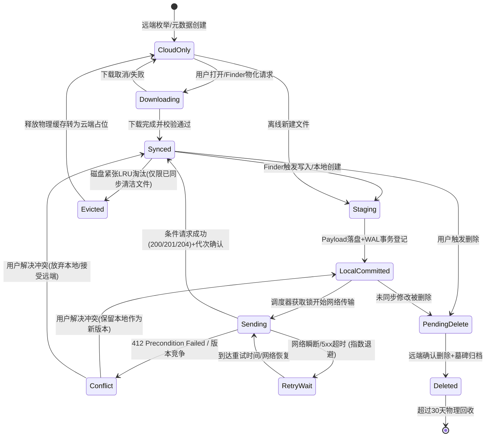
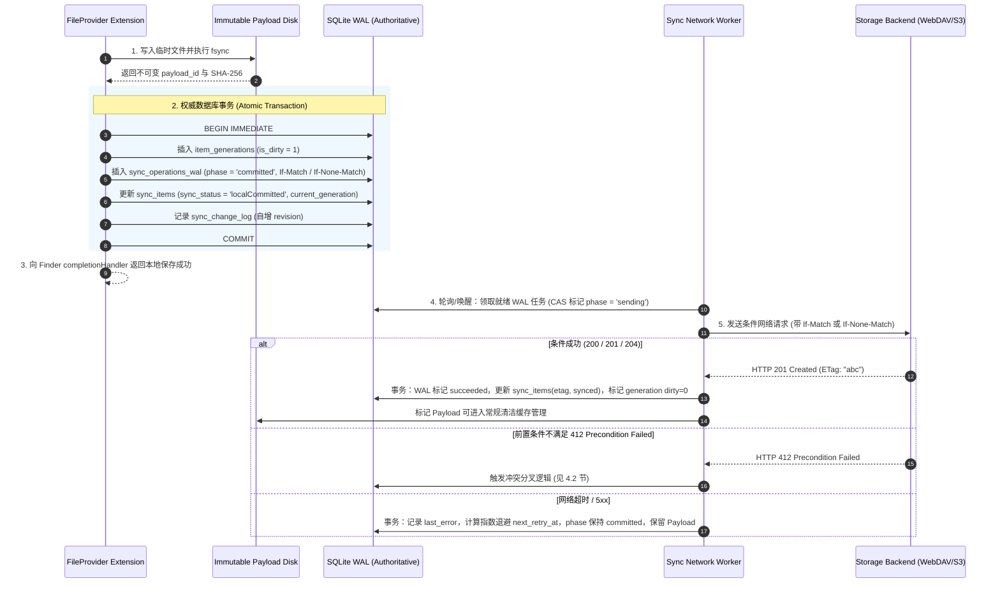

# CloudDrive 同步内核与状态机规范 (Sync Specification)

本规范为 CloudDrive 同步引擎（Sync Engine）的权威设计蓝图，定义了状态转换图、权威数据库 DDL、事务提交流程、冲突分叉算法与崩溃恢复机制。

---

## 1. 核心设计原则与数据保证

1. **不可变代次 (Immutable Generations)**：
   每次本地修改必须生成全局唯一的 `generation_id`（UUIDv4），并将文件写入独立路径 `Payloads/<vaultId>/<generation_id>`。严禁直接在共享缓存文件上做增量修改，防止在途上传与并发编辑冲突。
2. **先落盘、再登记、后确认 (Write-Ahead Staging & Commit)**：
   在向 Finder 确认保存成功（调用 completionHandler）之前，必须依次完成：① 临时 Payload 可靠落盘（带 fsync）；② SQLite WAL 事务写入（关联代次与操作意图）。绝不依靠内存队列或尚未持久化的 JSON。
3. **租约与脏数据保护 (Cache Leases & Dirty Protection)**：
   所有未上传（Dirty）、正在交付、或处于活动编辑状态的文件，由 `cache_leases` 锁定。LRU 驱逐策略**绝对禁止**清理持有活跃租约或未确认远端代次的文件。
4. **前置条件与冲突分叉 (Conditional Writes & Conflict Forking)**：
   远端写入必须携带条件头：新建使用 `If-None-Match: *`，修改使用 `If-Match: <baseETag>`。当服务端返回 412 Precondition Failed 时，绝不盲目覆盖，自动保留本地修改为冲突副本并向用户提供决议分支。
5. **墓碑与可恢复删除 (Tombstones & Non-destructive Delete)**：
   本地或远端删除时先建立持久墓碑（Tombstone），并保留本地恢复副本至少 30 天。未向远端提交成功前，底层物理路径与父子映射完整保留。

---

## 2. 同步状态机 (State Machine)

### 2.1 状态流转图



### 2.2 状态定义与语义约束表

| 状态枚举 | 物理缓存是否存在 | 本地有未同步修改 (Dirty) | 驱逐保护 (Lease) | Finder 显示语义 | 说明 |
|---|---|---|---|---|---|
| `.cloudOnly` | 否 | 否 | 无 | ☁️ 云端占位 | 仅有元数据，无本地物理文件。 |
| `.downloading` | 部分 | 否 | 读租约 | ⏳ 下载中进度条 | 临时文件下载中，未原子发布至缓存。 |
| `.synced` | 是 | 否 | 可配置 Pin | ✅ 已同步 | 本地内容与远端最新 ETag 完全一致。 |
| `.staging` | 临时 | 是 | 写租约 | ⏳ 保存中 | 正在由 Finder 写入临时目录，尚未落盘。 |
| `.localCommitted` | 是 (Payload) | 是 | 强租约 (禁止驱逐) | ⏳ 等待上传 | 本地事务已确认，等待网络发送。 |
| `.sending` | 是 (Payload) | 是 | 强租约 (禁止驱逐) | ⬆️ 正在上传 | 网络传输正在进行，持有执行锁。 |
| `.conflict` | 是 (双方副本) | 是 | 强租约 | ⚠️ 冲突待决 | 412 或双向修改分叉，等待用户解决。 |
| `.pendingDelete` | 否 (转入隔离区) | 是 (删除意图) | 墓碑保护 | 🗑️ 等待删除 | 远端尚未删除，本地已进入待删墓碑。 |
| `.deleted` | 否 (可恢复包) | 否 | 历史归档 | 不显示 | 远端已删，本地保留恢复元数据。 |

---

## 3. 权威 SQLite 数据库架构 (DDL)

每个 Vault 在独立路径拥有自己的权威 SQLite 数据库：`Vaults/<vaultId>/sync_v2.db`。采用 SQLite WAL 模式保证并发读写安全性。

```sql
-- 开启 WAL 模式与外键约束
PRAGMA journal_mode = WAL;
PRAGMA synchronous = NORMAL;
PRAGMA foreign_keys = ON;

-- 1. 对象核心元数据表 (Items Metadata)
CREATE TABLE IF NOT EXISTS sync_items (
    vault_id            TEXT NOT NULL,
    object_id           TEXT NOT NULL,              -- 稳定逻辑 ID (UUIDv4)
    parent_id           TEXT,                       -- 父目录 object_id (根目录为 NULL)
    name                TEXT NOT NULL,              -- 显示名称
    is_directory        INTEGER NOT NULL DEFAULT 0,
    size                INTEGER NOT NULL DEFAULT 0,
    etag                TEXT,                       -- 远端确认的强 ETag
    remote_path         TEXT NOT NULL,              -- 远端物理路径/密文路径
    local_modified_at   REAL NOT NULL,              -- 本地修改时间戳 (Unix Epoch)
    remote_modified_at  REAL,                       -- 远端修改时间戳
    sync_status         TEXT NOT NULL,              -- 当前状态 (见 2.2 节枚举)
    pin_policy          TEXT NOT NULL DEFAULT 'automatic', -- 'automatic', 'pinned', 'inherited'
    current_generation  TEXT,                       -- 当前活跃本地代次 ID
    created_at          REAL NOT NULL,
    updated_at          REAL NOT NULL,
    PRIMARY KEY (vault_id, object_id),
    FOREIGN KEY (vault_id, parent_id) REFERENCES sync_items(vault_id, object_id) ON DELETE RESTRICT
);

CREATE INDEX IF NOT EXISTS idx_sync_items_parent ON sync_items(vault_id, parent_id);
CREATE INDEX IF NOT EXISTS idx_sync_items_status ON sync_items(vault_id, sync_status);
CREATE INDEX IF NOT EXISTS idx_sync_items_remotepath ON sync_items(vault_id, remote_path);

-- 2. 事务操作日志表 (Write-Ahead Operation WAL)
CREATE TABLE IF NOT EXISTS sync_operations_wal (
    operation_id        TEXT PRIMARY KEY,           -- 操作唯一 ID (UUIDv4)
    vault_id            TEXT NOT NULL,
    object_id           TEXT NOT NULL,              -- 关联的对象 ID
    parent_id           TEXT,
    operation_type      TEXT NOT NULL,              -- 'createFile', 'modifyContent', 'createDir', 'move', 'delete'
    generation          TEXT NOT NULL,              -- 本操作产生的不可变代次 ID
    payload_id          TEXT,                       -- 物理 Payload 文件名 (Payloads/<vaultId>/<payload_id>)
    payload_size        INTEGER DEFAULT 0,
    payload_hash        TEXT,                       -- SHA-256 校验和
    source_path         TEXT,                       -- 源远端路径 (移动/重命名)
    target_path         TEXT NOT NULL,              -- 目标远端路径
    expected_base_etag  TEXT,                       -- 期待的基线版本 (用于 If-Match，新建为 NULL)
    dependency_ids      TEXT,                       -- JSON 数组：前置依赖的 operation_id 列表
    phase               TEXT NOT NULL DEFAULT 'prepared', -- 'prepared', 'committed', 'sending', 'succeeded', 'failed', 'blocked'
    retry_count         INTEGER NOT NULL DEFAULT 0,
    next_retry_at       REAL,
    last_error_code     TEXT,
    last_error_message  TEXT,
    created_at          REAL NOT NULL,
    updated_at          REAL NOT NULL,
    FOREIGN KEY (vault_id, object_id) REFERENCES sync_items(vault_id, object_id) ON DELETE CASCADE
);

CREATE INDEX IF NOT EXISTS idx_wal_queue ON sync_operations_wal(vault_id, phase, next_retry_at);
CREATE INDEX IF NOT EXISTS idx_wal_object ON sync_operations_wal(vault_id, object_id);

-- 3. 不可变代次表 (Item Generations)
CREATE TABLE IF NOT EXISTS item_generations (
    generation_id       TEXT PRIMARY KEY,
    vault_id            TEXT NOT NULL,
    object_id           TEXT NOT NULL,
    payload_path        TEXT NOT NULL,              -- 相对或绝对物理路径
    size                INTEGER NOT NULL,
    sha256              TEXT NOT NULL,
    is_dirty            INTEGER NOT NULL DEFAULT 1, -- 1: 尚未被远端完全确认; 0: 已同步清洁
    committed_at        REAL NOT NULL,              -- 本地确认时间
    confirmed_at        REAL,                       -- 远端确认时间
    etag_received       TEXT,                       -- 成功上传后服务端返回的 ETag
    FOREIGN KEY (vault_id, object_id) REFERENCES sync_items(vault_id, object_id) ON DELETE CASCADE
);

CREATE INDEX IF NOT EXISTS idx_generations_object ON item_generations(vault_id, object_id, is_dirty);

-- 4. 墓碑记录表 (Tombstones - 保证从旧 Anchor 回放删除与防复活)
CREATE TABLE IF NOT EXISTS sync_tombstones (
    tombstone_id        TEXT PRIMARY KEY,
    vault_id            TEXT NOT NULL,
    object_id           TEXT NOT NULL,
    last_known_name     TEXT NOT NULL,
    remote_path         TEXT NOT NULL,
    base_etag           TEXT,
    deleted_at          REAL NOT NULL,
    remote_confirmed    INTEGER NOT NULL DEFAULT 0, -- 是否已在远端执行成功
    recovery_payload_id TEXT,                       -- 本地备份包 (供用户“最近删除”恢复)
    retention_until     REAL NOT NULL               -- 物理清理过期时间戳 (+30天)
);

CREATE INDEX IF NOT EXISTS idx_tombstones_vault ON sync_tombstones(vault_id, remote_confirmed, retention_until);

-- 5. 缓存租约与锁表 (Cache Leases - 保护活跃文件不被 LRU 清理)
CREATE TABLE IF NOT EXISTS cache_leases (
    lease_id            TEXT PRIMARY KEY,
    vault_id            TEXT NOT NULL,
    object_id           TEXT NOT NULL,
    holder_component    TEXT NOT NULL,              -- 'FileProvider', 'ThumbnailGenerator', 'Uploader'
    lease_type          TEXT NOT NULL,              -- 'read', 'write', 'pinned'
    acquired_at         REAL NOT NULL,
    expires_at          REAL NOT NULL,              -- 超时时间 (防止进程崩溃产生永久死锁)
    FOREIGN KEY (vault_id, object_id) REFERENCES sync_items(vault_id, object_id) ON DELETE CASCADE
);

CREATE INDEX IF NOT EXISTS idx_cache_leases_lookup ON cache_leases(vault_id, object_id, expires_at);

-- 6. 增量变更日志表 (Change Log - 专供 FileProvider enumerateChanges 查询)
CREATE TABLE IF NOT EXISTS sync_change_log (
    revision            INTEGER PRIMARY KEY AUTOINCREMENT,
    vault_id            TEXT NOT NULL,
    object_id           TEXT NOT NULL,
    change_type         TEXT NOT NULL,              -- 'added', 'updated', 'deleted'
    changed_at          REAL NOT NULL
);

CREATE INDEX IF NOT EXISTS idx_change_log_rev ON sync_change_log(vault_id, revision);
```

---

## 4. 核心事务流程

### 4.1 新建文件与修改提交序列 (Commit Pipeline)



### 4.2 冲突检测与分叉算法 (Conflict Forking Protocol)

当修改操作收到 `412 Precondition Failed` 或新建收到 `412 / 409 Conflict` 时：

1. **绝对禁止回退为无条件覆盖**：严禁剥离 `If-Match` 重新 PUT。
2. **下载当前远端新版本**：
   - 提取远端当前的 ETag 与内容，存入临时缓存。
   - 解析远端修改者信息与远端修改时间。
3. **保留本地修改并自动分叉**：
   - 原 `object_id` 接受远端新版本，元数据更新为远端 ETag，状态转为 `.synced`。
   - 为本地未同步的内容创建新的分叉文件：
     - 文件名规则：`<原文件名> (与远端冲突的副本 <格式化日期时间>).<扩展名>`。
     - 生成全新的 `object_id_fork`。
     - 写入 `sync_operations_wal` 作为全新的 `createFile` 任务（携带 `If-None-Match: *`）。
4. **通知系统与用户界面**：
   - 向 Finder 触发当前目录的刷新通知，展示并列的两个文件。
   - 在应用 UI 的“同步冲突中心”展示分叉提示，供用户比对或决定是否合并删除其中一个。

---

## 5. 崩溃恢复与启动对账规范 (Crash Recovery)

当应用启动或 File Provider 扩展进程被系统重启时，必须按以下顺序执行启动自愈：

1. **WAL 悬空任务对账**：
   - 查询 `phase = 'sending'` 的所有任务。由于进程意外退出，网络请求可能已经发送到服务端，也可能尚未发出。
   - 将其重置为 `phase = 'committed'`，并在执行前**先发起 HEAD 请求核对**：
     - 若服务端的 ETag/大小/校验和与本地 Payload 一致，判定上一次实际已发送成功，直接补交成功事务。
     - 若服务端内容未变，按原计划重新发送。
2. **孤儿 Payload 清理**：
   - 扫描 `Payloads/` 目录下的所有文件，与 `item_generations` 和 `sync_operations_wal` 对账。
   - 任何不在数据库中、且修改时间超过 2 小时的无主临时文件才允许安全物理删除。
3. **数据库损坏防护**：
   - 启动时执行 `PRAGMA integrity_check(100)`。
   - 发生数据库损坏时，**禁止静默删除重建**。必须将损坏的 `sync_v2.db` 重命名归档为 `sync_v2_corrupted_<timestamp>.db`，并保留所有已有 Payloads，提示用户导出未同步修改后再初始化。
